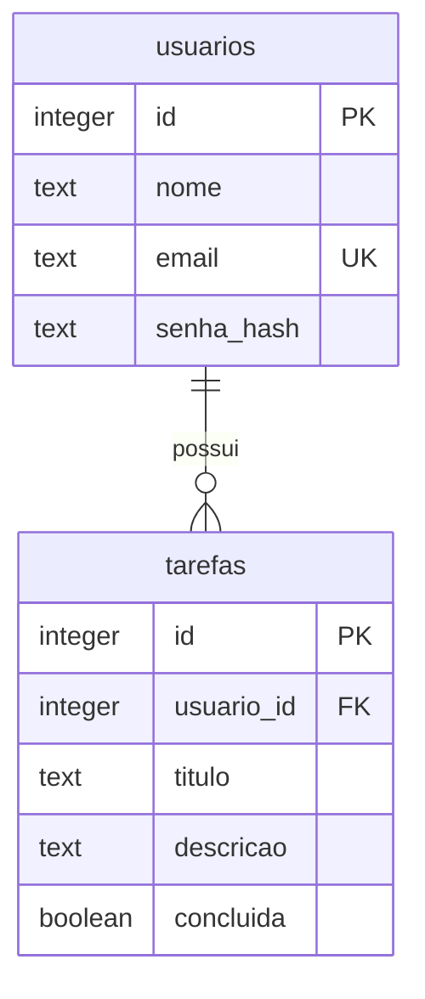

# TaskEasy

Aplicativo acadêmico de gerenciamento de tarefas pessoais, desenvolvido com React Native, Expo e uma API Node.js/Express.

O projeto busca ajudar pessoas que precisam organizar suas atividades diárias em um único lugar. A solução proposta é um aplicativo simples para consultar, cadastrar, editar e concluir tarefas pessoais, com acesso individual por usuário. Sua utilidade está em tornar visíveis as pendências e facilitar o acompanhamento do que já foi feito.

## Estado do projeto: Etapa 1 — Estrutura inicial

Esta etapa entrega a estrutura dos projetos, dependências essenciais, comandos de execução, uma tela de boas-vindas e uma API com a rota de diagnóstico `GET /health`.

**Login, persistência, CRUD, navegação funcional e integração com a API externa ainda não estão implementados.** A próxima etapa depende de autorização. Não existem usuários, tarefas ou respostas simuladas dessas funcionalidades.

## Tecnologias

| Camada | Configurado nesta etapa | Próximas etapas |
| --- | --- | --- |
| Aplicativo | JavaScript, Expo SDK 57, React Native, React Native Paper, StyleSheet | Telas funcionais |
| Navegação | React Navigation 7 (Native Stack e Bottom Tabs) e dependências instaladas | Rotas e proteção por autenticação |
| Estado e dispositivo | AsyncStorage e Expo Haptics instalados | Context API, sessão, tema e vibração |
| Comunicação | Fetch nativo disponível no React Native | Consumo da API real e de uma API pública de frases |
| Backend | Node.js, Express 5, CORS e dotenv | SQLite, JWT e bcrypt |

As dependências de banco e autenticação serão instaladas na etapa que as utilizar. O template `blank` mantém o aplicativo em JavaScript, sem Expo Router. Os módulos nativos são instalados com `expo install` para respeitar o SDK. Os arquivos `package-lock.json` registram as versões instaladas.

## Estrutura

```text
Taskeasy/
├── api/
│   ├── .env.example
│   ├── package.json
│   ├── package-lock.json
│   └── src/
│       ├── app.js
│       ├── server.js
│       ├── controllers/
│       ├── database/
│       ├── middleware/
│       ├── routes/
│       └── services/
├── mobile/
│   ├── .env.example
│   ├── App.js
│   ├── app.json
│   ├── index.js
│   ├── assets/
│   ├── package.json
│   ├── package-lock.json
│   └── src/
│       ├── components/
│       ├── context/
│       ├── hooks/
│       ├── navigation/
│       ├── screens/
│       ├── services/
│       └── theme.js
├── .gitattributes
├── .gitignore
└── README.md
```

Os arquivos `.gitkeep` preservam no Git as pastas reservadas para as próximas etapas.

## Pré-requisitos

- Node.js 20.19.4 ou superior compatível com o SDK (o ambiente inicial utiliza 20.20.0) e npm.
- VS Code e Git.
- Um celular Android com Expo Go compatível com o SDK 57, ou um emulador Android configurado.
- Computador e celular na mesma rede Wi-Fi para os testes locais.

Confira o SDK do Expo Go em [expo.dev/go](https://expo.dev/go). Se houver incompatibilidade, selecione SDK 57 e Android nessa página e siga as instruções oficiais.

Os comandos abaixo usam `npm.cmd` e `npx.cmd` no PowerShell do Windows, evitando o bloqueio de scripts `.ps1`. Em outros terminais, podem ser usados `npm` e `npx`.

## Como executar no VS Code

Abra no VS Code a pasta raiz `Taskeasy` e use **Terminal → Novo Terminal**. As dependências já estarão instaladas no ambiente em que esta etapa foi preparada. Em uma cópia nova do repositório, execute na raiz:

```powershell
npm.cmd ci --prefix api
npm.cmd ci --prefix mobile
```

### Terminal 1: backend

```powershell
cd api
Copy-Item .env.example .env
npm.cmd run dev
```

Copie o `.env` apenas na primeira execução; preserve alterações locais nas próximas vezes. A API escuta em `0.0.0.0:3000`, permitindo conexões da rede local. A porta pode ser alterada em `api/.env`.

Para executar sem reinicialização automática:

```powershell
npm.cmd start
```

Teste em outro terminal PowerShell, mantendo o servidor em execução:

```powershell
Invoke-RestMethod http://localhost:3000/health
```

Resposta esperada (HTTP 200):

```json
{ "status": "ok", "service": "TaskEasy API" }
```

### Terminal 2: aplicativo

Abra um segundo terminal **na pasta raiz** do projeto:

```powershell
cd mobile
Copy-Item .env.example .env
npm.cmd start
```

Abra o Expo Go no Android e escaneie o QR code mostrado no terminal. A tela deve exibir **TaskEasy**, **Mais clareza para o seu dia.** e o cartão **Uma tarefa de cada vez.**

O comando `start` utiliza a rede local (`--lan`). Para um emulador Android já aberto, use `npm.cmd run android`, ou pressione `a` no terminal do Expo. Não é necessário instalar o aplicativo Android Studio para testar pelo Expo Go em um celular físico.

Encerre cada processo com `Ctrl+C` no seu respectivo terminal.

### Acesso à API pelo celular físico

1. No computador, execute `ipconfig` e localize o **Endereço IPv4** do adaptador Wi-Fi ativo, por exemplo `192.168.1.100`.
2. Com o backend em execução, abra no navegador do celular `http://192.168.1.100:3000/health`, substituindo pelo IPv4 real. O JSON da API deve aparecer.
3. Ajuste `mobile/.env` para `EXPO_PUBLIC_API_URL=http://SEU_IPV4:3000`. Essa variável está reservada para a integração HTTP das próximas etapas; a tela inicial ainda não faz requisições.
4. Reinicie o Expo após alterar `.env`. Caso necessário, use `npx.cmd expo start --lan --clear`.

No celular, `localhost` aponta para o próprio telefone. Use o IPv4 do computador. Se houver bloqueio, confira a rede Wi-Fi e permita o Node.js no Firewall do Windows **para a rede privada de testes**. Não desative o firewall. Redes de convidados podem impedir comunicação entre os dispositivos. Se a porta da API mudar, atualize também a URL.

O túnel do Expo transporta o aplicativo, mas não publica a API Express. A API ainda precisa estar acessível pelo celular.

Variáveis `EXPO_PUBLIC_*` são públicas no aplicativo. Nunca coloque senhas ou segredos JWT nelas. Arquivos `.env`, bancos locais e `node_modules` estão ignorados pelo Git; somente os exemplos devem ser versionados.

## Verificação desta etapa

Na raiz:

```powershell
npm.cmd run check --prefix mobile
npm.cmd run export:android --prefix mobile
```

O primeiro comando verifica as versões esperadas pelo Expo. O segundo gera o bundle Android em `mobile/dist` (ignorado pelo Git), verificando a compilação JavaScript e os imports. Ele não gera um APK nem substitui o teste visual em um celular.

Teste manualmente:

- `GET /health`: HTTP 200 e o JSON documentado.
- Uma rota inexistente, como `/inexistente`: HTTP 404 com uma mensagem em português.
- Aplicativo: abertura da tela inicial, legibilidade e conteúdo em uma tela Android.
- Rede local: acesso ao `/health` pelo navegador do celular.

Ainda não há suíte de testes de funcionalidades, pois elas serão criadas nas próximas etapas.

Verificações executadas na preparação: requisições HTTP reais à API (200, 404, 400 e 413), sintaxe do servidor, compatibilidade das dependências, **21/21 verificações do Expo Doctor** e exportação do bundle Android. O teste visual no celular e o acesso pela rede Wi-Fi precisam ser realizados no dispositivo com os passos acima.

### Auditoria de dependências

Na preparação desta etapa, a instalação da API informou **zero vulnerabilidades**. No mobile, `npm audit` informou **quatro ocorrências moderadas** na cadeia `expo → @expo/fingerprint → glob/minimatch`. A correção automática sugerida pelo npm troca o Expo 57 pelo 53, comprometendo a compatibilidade do projeto. Por isso, essa troca não foi aplicada; os avisos permanecem registrados para acompanhamento das atualizações do Expo. Não execute `npm audit fix --force` sem revisar a alteração do SDK.

Para consultar novamente os relatórios:

```powershell
npm.cmd audit --prefix api
npm.cmd audit --prefix mobile
```

## Endpoints

| Método | Rota | Estado |
| --- | --- | --- |
| GET | `/health` | Implementado: verifica se o servidor está respondendo |
| POST | `/auth/login` | Planejado |
| GET | `/tasks` | Planejado |
| GET | `/tasks/:id` | Planejado |
| POST | `/tasks` | Planejado |
| PUT | `/tasks/:id` | Planejado |
| DELETE | `/tasks/:id` | Planejado |

## DER planejado

Este é apenas o desenho conceitual para a etapa de persistência. Nenhum banco ou tabela foi criado nesta etapa.



O usuário de demonstração e suas credenciais serão documentados quando a autenticação e a criação do usuário local forem implementadas. Ainda não há credenciais para testar login.

## Git e próximas etapas

O trabalho inicial utiliza a branch `feat/estrutura-inicial`. Nas próximas etapas, utilize branches por funcionalidade, por exemplo `feat/autenticacao` e `feat/tarefas`, com commits descritivos. Nenhum repositório remoto ou publicação no GitHub é necessário para executar localmente.

Exemplos de fluxo após revisar e integrar a etapa anterior à `main`:

```powershell
git switch main
git switch -c feat/autenticacao
```

Cada nova etapa deve ter escopo pequeno, verificação, instruções de teste e autorização antes de avançar.

## Referências oficiais

- [Expo: criação do projeto e template blank](https://docs.expo.dev/more/create-expo/)
- [React Navigation: instalação e dependências nativas](https://reactnavigation.org/docs/getting-started/)
- [React Native Paper: configuração inicial](https://callstack.github.io/react-native-paper/docs/guides/getting-started/)
- [Express: instalação](https://expressjs.com/en/starter/installing/)
