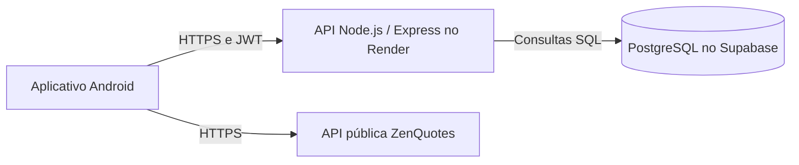
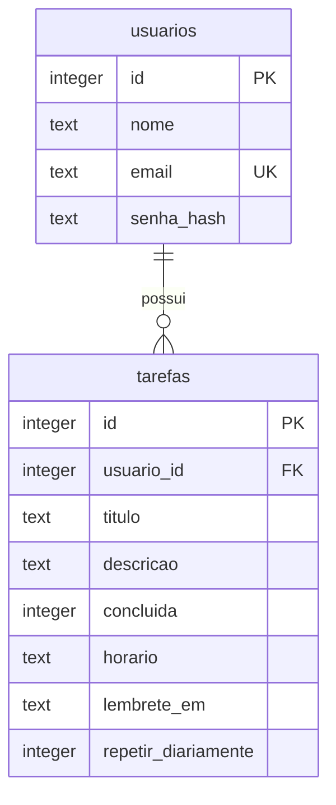

# TaskEasy

Desenvolvemos o TaskEasy como um aplicativo Android para organizar tarefas pessoais. Nele, podemos cadastrar atividades, acompanhar o que está pendente, marcar tarefas como concluídas e definir horários para lembretes com despertador.

A versão principal do projeto utiliza uma **API Node.js publicada no Render** e um **banco PostgreSQL no Supabase**. O aplicativo acessa esses serviços pela internet, sem precisar manter um computador ligado ou estar na mesma rede Wi-Fi.

## Acesso à versão publicada

| Componente | Acesso |
| --- | --- |
| Aplicativo Android | [Baixar TaskEasy 1.1.0 — TaskEasy-APK-3](https://github.com/Guilhermeqz/TaskEasy/actions/runs/43336605357/artifacts/13998945369) |
| API no Render | https://taskeasy-ejrv.onrender.com |
| Verificação da API | https://taskeasy-ejrv.onrender.com/health |
| Banco de dados | PostgreSQL hospedado no Supabase, acessado pela API |

Para instalar, entre em uma conta com acesso ao repositório, baixe o ZIP do APK, extraia o arquivo `TaskEasy.apk` e abra-o no Android. Se o aparelho solicitar, autorize a instalação pela origem usada para baixar o arquivo. O APK funciona sem Expo Go ou servidor de desenvolvimento.

Os artefatos do GitHub Actions têm prazo de disponibilidade. Se o download tiver expirado, podemos gerar outro APK pelo workflow **Gerar APK Android**, usando a branch `main` e a URL pública da API. O procedimento está em [Geração do APK](docs/APK-GITHUB.md).

### Login de demonstração

- **E-mail:** `demo@taskeasy.com`
- **Senha:** `TaskEasy@123`

Utilizamos essa conta para a demonstração acadêmica. As tarefas ficam vinculadas ao usuário autenticado. Quem utiliza a mesma conta de demonstração acessa a mesma lista de tarefas.

### Antes de usar ou apresentar

Abra o endereço de verificação da API e aguarde a resposta:

```json
{ "status": "ok", "service": "TaskEasy API" }
```

Depois, abra o aplicativo e faça login. Como usamos uma instância gratuita do Render, a primeira resposta pode demorar após um período sem acessos. Para testar o despertador, confira as permissões em **Perfil → Despertadores** e o volume de alarmes do celular.

O login e as operações de tarefas precisam de internet. Os despertadores já agendados no aparelho podem tocar sem conexão. O [roteiro de apresentação](docs/APRESENTACAO-WEB.md) reúne os passos para conferir essas funções.

## Problema e proposta

Durante a rotina, é comum distribuir atividades entre anotações, mensagens e lembretes separados. Isso dificulta acompanhar as pendências e lembrar o horário de cada compromisso.

Nossa proposta foi reunir essas informações em um aplicativo simples: uma lista de tarefas com título, descrição, status e horário opcional. Assim, conseguimos consultar o que precisa ser feito, atualizar o andamento e receber um aviso no horário definido.

### Por que escolhemos esse projeto

Escolhemos esse tema pela utilidade na nossa rotina de estudos e compromissos. Queremos usar o TaskEasy para reunir atividades da faculdade e tarefas do dia a dia em um único lugar, acompanhar o que já concluímos e lembrar das atividades com horário marcado.

## Funcionalidades

- Login com e-mail e senha, autenticação por JWT e manutenção da sessão ao reabrir o aplicativo.
- Lista de tarefas com título, status, atualização ao retornar à tela e gesto de puxar para atualizar.
- Cadastro e edição com o mesmo formulário, campos controlados e validação do título obrigatório.
- Tela de detalhes, conclusão da tarefa e confirmação antes de excluir.
- Vibração ao concluir uma tarefa, utilizando Expo Haptics.
- Despertador por horário, com toque contínuo até ser interrompido e opção de repetição diária.
- Perfil com nome, e-mail, logout e preferência de tema claro ou escuro salva no aparelho.
- Frase motivacional obtida da API pública ZenQuotes, com carregamento, tratamento de erro e atribuição da fonte.
- Estados de carregamento, lista vazia e mensagens de erro nas operações.

As frases são exibidas no idioma recebido da ZenQuotes, geralmente inglês. Uma falha nesse serviço não impede o uso das tarefas. A conta de demonstração já está cadastrada; o aplicativo não possui uma tela de criação de contas.

## Como o projeto funciona

O aplicativo envia as requisições para nossa API Express no Render. A API valida os dados e a autenticação, executa as consultas no PostgreSQL do Supabase e devolve a resposta ao aplicativo. A consulta de frases é feita diretamente pelo aplicativo à ZenQuotes.



Guardamos o token de acesso e a preferência de tema no AsyncStorage. As senhas dos usuários são armazenadas no banco como hashes bcrypt. As rotas de tarefas exigem o header `Authorization: Bearer TOKEN`, e a API utiliza o usuário do token para restringir o acesso aos registros.

As credenciais do banco e o segredo JWT ficam nas variáveis de ambiente do backend. O aplicativo recebe apenas a URL pública da API.

## Tecnologias utilizadas

| Parte do projeto | Tecnologias |
| --- | --- |
| Aplicativo | JavaScript, React Native e Expo SDK 57 |
| Interface | React Native Paper, StyleSheet e Safe Area Context |
| Navegação | React Navigation com Native Stack e Bottom Tabs |
| Estado e persistência no aparelho | Context API, hooks e AsyncStorage |
| Requisições e vibração | Fetch e Expo Haptics |
| Despertador Android | Módulo nativo em Kotlin, AlarmManager e serviço de áudio |
| API | Node.js, Express, pg, bcrypt e jsonwebtoken |
| Hospedagem da API | Render |
| Banco principal | PostgreSQL no Supabase |
| Testes e compilação | Node Test Runner, Jest, React Native Testing Library e GitHub Actions |

## Organização do repositório

```text
TaskEasy/
├── mobile/
│   ├── App.js
│   ├── app.json
│   ├── modules/taskeasy-alarm/
│   ├── src/
│   │   ├── screens/
│   │   ├── components/
│   │   ├── hooks/
│   │   ├── services/
│   │   ├── context/
│   │   └── navigation/
│   └── tests/
├── api/
│   ├── src/
│   │   ├── controllers/
│   │   ├── routes/
│   │   ├── services/
│   │   ├── middleware/
│   │   └── database/
│   ├── scripts/
│   └── tests/
├── .github/workflows/
├── docs/
├── render.yaml
└── README.md
```

Separamos as telas dos componentes reutilizáveis e concentramos as chamadas HTTP em services. O hook `useTasks` controla a listagem, o carregamento e os erros; os contextos cuidam da autenticação e do tema. Na API, utilizamos routes, controllers, services e middleware para separar as responsabilidades.

## Dados e relacionamentos

Utilizamos as tabelas `usuarios` e `tarefas`. Cada tarefa pertence a um usuário, e um usuário pode ter várias tarefas.



O e-mail é único sem distinguir maiúsculas e minúsculas. `usuario_id` é a chave estrangeira que relaciona a tarefa ao seu dono. Os campos `concluida` e `repetir_diariamente` são armazenados como `0` ou `1` e retornados pela API como booleanos.

O campo `horario` utiliza o formato `HH:mm`, e `lembrete_em` guarda o instante do agendamento em ISO UTC. O aplicativo apresenta o horário local do celular. A configuração do despertador está detalhada em [Despertadores](docs/DESPERTADORES.md).

## Endpoints da API

URL base: `https://taskeasy-ejrv.onrender.com`.

| Método | Rota | Finalidade | Autenticação |
| --- | --- | --- | --- |
| GET | `/health` | Verificar o servidor e o acesso ao banco | Não |
| POST | `/auth/login` | Autenticar e obter token e perfil | Não |
| GET | `/auth/me` | Consultar o usuário autenticado | JWT |
| GET | `/tasks` | Listar tarefas do usuário | JWT |
| GET | `/tasks/:id` | Consultar uma tarefa | JWT |
| POST | `/tasks` | Criar uma tarefa | JWT |
| PUT | `/tasks/:id` | Atualizar uma tarefa | JWT |
| DELETE | `/tasks/:id` | Excluir uma tarefa | JWT |

Corpo do login:

```json
{ "email": "demo@taskeasy.com", "password": "TaskEasy@123" }
```

Exemplo de cadastro de tarefa:

```json
{
  "titulo": "Estudar React Native",
  "descricao": "Revisar navegação e Context API",
  "concluida": false
}
```

O título é obrigatório e aceita até 120 caracteres; a descrição aceita até 2000. Os campos opcionais de agendamento são `horario`, `lembrete_em` e `repetir_diariamente`.

A criação retorna `201`, as consultas e atualizações retornam `200`, e a exclusão retorna `204`. Dados inválidos recebem `400`, falhas de autenticação recebem `401` e tarefas inexistentes ou de outro usuário recebem `404`. Os erros utilizam o formato `{ "message": "..." }`.

## Desenvolvimento e publicação

Para usar o APK pronto, basta instalá-lo e ter acesso à internet. Os comandos desta seção são para trabalhar no código ou reproduzir a publicação.

### Preparar o código

Utilizamos Node.js 20.20.0, npm e Git. No PowerShell do Windows, usamos `npm.cmd` e `npx.cmd`; em outros terminais, os comandos equivalentes são `npm` e `npx`.

```powershell
git clone https://github.com/Guilhermeqz/TaskEasy.git
cd TaskEasy
npm.cmd ci --prefix api
npm.cmd ci --prefix mobile
```

O repositório é privado, portanto a conta usada no clone precisa ter acesso.

### Aplicativo em desenvolvimento com a API publicada

Crie ou ajuste `mobile/.env` com o endereço público:

```dotenv
EXPO_PUBLIC_API_URL=https://taskeasy-ejrv.onrender.com
```

Na raiz do projeto, inicie o ambiente Expo:

```powershell
npm.cmd start --prefix mobile
```

Esse comando inicia o servidor de desenvolvimento. O despertador utiliza um módulo nativo Android e precisa do APK próprio para funcionar; seu comportamento não é reproduzido pelo Expo Go.

Para gerar o APK, abra **Actions → Gerar APK Android → Run workflow** no GitHub, selecione `main` e informe `https://taskeasy-ejrv.onrender.com` no campo `api_url`.

### API no Render e banco no Supabase

Publicamos a pasta `api` como um **Web Service Node** no Render, com estas configurações:

| Configuração | Valor |
| --- | --- |
| Root Directory | `api` |
| Build Command | `npm ci --omit=dev` |
| Start Command | `npm start` |
| Health Check Path | `/health` |

As variáveis do backend são:

| Variável | Uso |
| --- | --- |
| `DATABASE_URL` | Conexão privada com o PostgreSQL do Supabase |
| `JWT_SECRET` | Segredo de pelo menos 32 caracteres para gerar e validar os tokens |
| `HOST` | `0.0.0.0` |
| `NODE_VERSION` | `20.20.0` |
| `NODE_ENV` | `production` |
| `SEED_DEMO` | `false` no serviço publicado, que já possui a conta de demonstração |
| `PORT` | Fornecida pelo Render |

O backend usa o **Session pooler** do Supabase com TLS e verificação do certificado. Os arquivos `.env` e as credenciais reais ficam fora do Git. Para executar uma cópia da API com acesso ao PostgreSQL, configure as variáveis privadas no ambiente e rode `npm.cmd start --prefix api`. A criação da conta demo em um banco novo pode ser habilitada com `SEED_DEMO=true`.

Os passos de configuração, migração e publicação estão em [Render e Supabase](docs/DEPLOY-RENDER-SUPABASE.md). O arquivo `render.yaml` também descreve a configuração do serviço.

## Testes

Na raiz do repositório:

```powershell
npm.cmd test --prefix api
npm.cmd test --prefix mobile
npm.cmd run check --prefix mobile
```

Os testes da API verificam autenticação, CRUD, isolamento entre usuários, persistência, horários e backup. No GitHub Actions, também executamos a integração com um PostgreSQL de testes separado do banco publicado. Os testes do aplicativo cobrem sessão, tema, formulário, vibração e regras de agendamento.

O APK 1.1.0 foi [compilado pelo GitHub Actions](https://github.com/Guilhermeqz/TaskEasy/actions/runs/43336605357) e testado no celular. A API publicada também passou por verificações de login, consulta, criação, edição e exclusão de tarefas. Para conferir o aplicativo antes de apresentar, seguimos o [roteiro da versão publicada](docs/APRESENTACAO-WEB.md).

## Versão local de contingência

Mantivemos uma versão local como reserva para situações em que a conexão com a internet não estiver disponível. Essa cópia utiliza API Node.js no computador, banco SQLite e um APK configurado para a rede local.

A versão está preservada na tag `apresentacao-local-v1`, e o pacote completo fica em `backups/TaskEasy-Apresentacao-Local-v1-Windows.zip` no computador de desenvolvimento. O pacote não é enviado ao Git, pois inclui o banco e configurações privadas. As instruções estão em [Apresentação local](APRESENTACAO-LOCAL.md).

Essa reserva precisa da rede configurada para o endereço esperado pelo APK local. Seus dados não são sincronizados automaticamente com o Supabase. Para o uso normal e a apresentação com internet, utilizamos a versão publicada descrita neste README.

## Versionamento

Organizamos o desenvolvimento em branches de funcionalidades e correções antes de integrar as alterações à `main`. A branch `main` contém a versão atual do projeto.

- `apk-web-v1.1.0`: código utilizado na compilação do APK com a API publicada.
- `apresentacao-local-v1`: versão local preservada como contingência.
