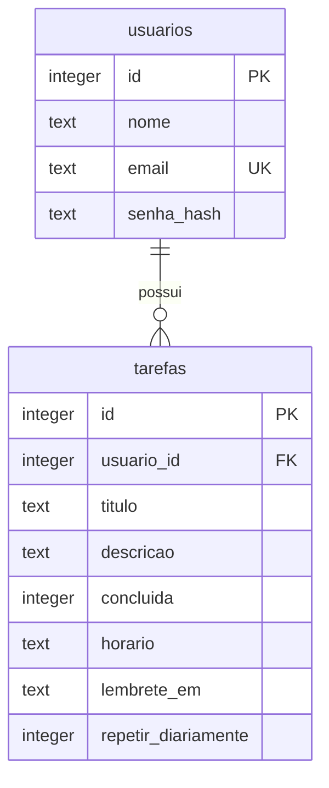

# TaskEasy

Aplicativo acadêmico Android para gerenciamento de tarefas pessoais, feito com React Native e Expo, com uma API Node.js/Express e persistência em SQLite local ou PostgreSQL no Supabase.

## Problema, solução e utilidade

Para a versão local preservada para apresentação, consulte [APRESENTACAO-LOCAL.md](APRESENTACAO-LOCAL.md) e execute `INICIAR-APRESENTACAO.cmd` na raiz. Ela mantém o APK já testado e a API SQLite local.

Para publicar a API com banco PostgreSQL externo e preservar a execução local, consulte [Render e Supabase](docs/DEPLOY-RENDER-SUPABASE.md). Sem `DATABASE_URL`, a API continua usando SQLite; com essa variável privada, usa PostgreSQL. A publicação depende da configuração das contas e da validação remota.

A API foi publicada em **https://taskeasy-ejrv.onrender.com**, com login e CRUD validados pela internet. Veja o [roteiro de apresentação da versão web](docs/APRESENTACAO-WEB.md), incluindo o teste com dados móveis e a reserva local.

Anotações espalhadas dificultam acompanhar atividades pessoais. O TaskEasy reúne pendências e tarefas concluídas em uma lista individual, acessível mediante login. A proposta é facilitar a organização do dia com cadastro, edição, conclusão e exclusão de tarefas, em uma interface simples em português brasileiro.

## Funcionalidades entregues

- Login com validação de campos, senha protegida com bcrypt e token JWT.
- Sessão no AsyncStorage, validada pela API ao reabrir o aplicativo. Falhas de rede permitem tentar novamente sem apagar o token; tokens expirados exigem novo login.
- Navegação protegida: Stack para login, detalhes e formulário; Bottom Tabs para Tarefas e Perfil.
- Lista com FlatList, keyExtractor, atualização ao retornar à tela e gesto de puxar para atualizar.
- Criação e edição pelo mesmo formulário, com título, descrição e Switch de conclusão.
- Horário opcional `HH:mm`, ocorrência única ou repetição diária e despertador contínuo no APK Android próprio. Veja [configuração e geração do APK](docs/DESPERTADORES.md).
- Detalhes, edição, confirmação antes de excluir e vibração após concluir uma tarefa salva com sucesso.
- Perfil com nome, e-mail, logout e preferência de tema persistida no aparelho.
- Frase motivacional obtida diretamente da API pública ZenQuotes, com carregamento, erro, nova tentativa e atribuição da fonte. As frases são exibidas no idioma original do serviço, geralmente inglês.
- Indicadores de carregamento, lista vazia e falhas de rede. Erros na API externa não bloqueiam as tarefas.
- SQLite com tabelas `usuarios` e `tarefas`, consultas parametrizadas e isolamento por usuário autenticado.

Não há cadastro de usuários na interface: o escopo solicitado utiliza um usuário de demonstração para testes locais.

## Tecnologias

| Camada | Tecnologias |
| --- | --- |
| Aplicativo | JavaScript, Expo SDK 57, React 19.2.3, React Native 0.86.3 |
| Interface | React Native Paper, StyleSheet e Safe Area Context |
| Navegação | React Navigation 7, Native Stack e Bottom Tabs |
| Estado e armazenamento | Context API, hooks customizados e AsyncStorage |
| Comunicação e dispositivo | Fetch, Expo Constants e Expo Haptics |
| Backend | Node.js, Express 5, better-sqlite3, pg (PostgreSQL), bcrypt, jsonwebtoken, dotenv e CORS |
| Testes | Node Test Runner, Jest, jest-expo e React Native Testing Library |

Os arquivos `package-lock.json` registram as versões instaladas. O renderer de testes acompanha exatamente o React 19.2.3. Os módulos nativos foram alinhados com `expo install`.

## Organização

```text
Taskeasy/
├── api/
│   ├── .env.example
│   ├── package.json / package-lock.json
│   ├── scripts/setup.js
│   ├── data/                       # Criada ao iniciar; banco ignorado pelo Git
│   ├── src/
│   │   ├── app.js / server.js
│   │   ├── controllers/            # Login, perfil e tarefas
│   │   ├── database/               # Schema SQLite e seed de demonstração
│   │   ├── middleware/             # JWT e erros
│   │   ├── routes/                 # /auth, /tasks e /health
│   │   └── services/               # Validação e regras de negócio
│   └── tests/                      # HTTP real, banco temporário e reinício do servidor
├── mobile/
│   ├── .env.example
│   ├── App.js / app.json / index.js
│   ├── package.json / package-lock.json
│   ├── jest.config.js / jest.setup.js
│   ├── assets/
│   ├── modules/taskeasy-alarm/     # Despertador nativo Android (APK próprio)
│   ├── plugins/                   # Configuração Android para API HTTP local
│   ├── eas.json                   # Perfil preview para gerar APK
│   ├── src/
│   │   ├── components/             # Formulário, estados e cartão de frase
│   │   ├── context/                # Autenticação e tema
│   │   ├── hooks/useTasks.js        # Lista, ações e vibração
│   │   ├── navigation/             # Stack e Bottom Tabs
│   │   ├── screens/                # Login, lista, detalhes, formulário e perfil
│   │   ├── services/               # API local, transporte HTTP e ZenQuotes
│   │   └── theme.js
│   └── tests/                      # Sessão, tema, formulário e conclusão
├── .gitattributes
├── .gitignore
└── README.md
```

## Instalação e execução no VS Code

Pré-requisitos: Node.js 20.19.4 ou superior compatível com o Expo (testado com 20.20.0), npm, Git, VS Code e um Android com Expo Go compatível com SDK 57. Para conferir o Expo Go correspondente, consulte [expo.dev/go](https://expo.dev/go).

Abra a pasta raiz `Taskeasy` no VS Code. No Windows/PowerShell, os comandos usam `npm.cmd` e `npx.cmd` para evitar bloqueios de scripts `.ps1`. Em outros terminais, use `npm` e `npx`.

Em uma cópia nova do projeto, instale as dependências na raiz:

```powershell
npm.cmd ci --prefix api
npm.cmd ci --prefix mobile
```

### Terminal 1: API

Na raiz do projeto:

```powershell
cd api
npm.cmd run setup
npm.cmd run dev
```

O comando `setup` cria `api/.env` com um segredo JWT aleatório local, sem exibi-lo no terminal. Se já existir um segredo válido, o arquivo é preservado. Não é necessário copiar o exemplo por cima do `.env` existente.

Ao iniciar, a API cria as tabelas e o usuário de demonstração se ainda não existirem. O arquivo padrão é `api/data/taskeasy.db`. Reiniciar a API preserva usuários e tarefas. O seed não recria nem altera o usuário existente.

Configurações de `api/.env`:

| Variável | Valor padrão / finalidade |
| --- | --- |
| `HOST` | `0.0.0.0`, permite acesso na rede local |
| `PORT` | `3000` |
| `JWT_SECRET` | Gerado por `npm run setup`; mínimo de 32 caracteres |
| `DATABASE_PATH` | `./data/taskeasy.db`, relativo à pasta api |
| `DATABASE_URL` | Opcional: conexão privada PostgreSQL; quando presente, substitui o uso de SQLite |
| `DATABASE_CA_CERT` | Opcional: CA PEM do provedor; o pooler Supabase já possui CA pública incluída no código |
| `SEED_DEMO` | `true`; `false` desativa a criação automática do usuário demo |

Para executar sem reinicialização automática, use `npm.cmd start` na pasta api. Encerre com `Ctrl+C`.

Teste em outro terminal:

```powershell
Invoke-RestMethod http://localhost:3000/health
```

Resposta esperada: `{ "status": "ok", "service": "TaskEasy API" }`.

### Terminal 2: aplicativo

Abra um segundo terminal na raiz:

```powershell
cd mobile
npm.cmd start
```

Abra o Expo Go no Android e escaneie o QR code. Computador e celular devem estar na mesma rede Wi-Fi. O app abre a tela de login. Para um emulador Android já configurado, pressione `a` no terminal do Expo ou use `npm.cmd run android`.

O comando de início utiliza `--lan`. Com `EXPO_PUBLIC_API_URL` vazio ou ausente, o aplicativo usa o host da sessão Expo para localizar o computador e conecta à porta 3000. Para emulador com host de loopback, usa `10.0.2.2` no Android.

No APK próprio, sem host de desenvolvimento, o endereço padrão é a API HTTPS configurada em `mobile/app.json`. O workflow também recebe explicitamente a URL pública em `api_url`. `EXPO_PUBLIC_API_URL` pode substituir esse endereço para compilar um APK local.

Para fixar o endereço, usar outra porta ou um túnel do Expo, copie o exemplo **somente se ainda não tiver um arquivo próprio**:

```powershell
Copy-Item .env.example .env
```

Edite `mobile/.env`:

```dotenv
EXPO_PUBLIC_API_URL=http://192.168.1.100:3000
```

Substitua pelo IPv4 real do computador, obtido com `ipconfig`. Depois reinicie o Expo; se necessário, use `npx.cmd expo start --lan --clear`.

No celular, `localhost` aponta para o próprio telefone. Para verificar a rede, abra `http://IPV4_DO_COMPUTADOR:3000/health` no navegador do Android. Se não abrir, confira a rede Wi-Fi e permita o Node.js no Firewall do Windows para a rede privada de testes, sem desativar o firewall. Redes de convidados podem bloquear comunicação entre dispositivos. O túnel do Expo não publica a API Express: ela precisa continuar acessível pelo celular.

Nunca coloque segredos em variáveis `EXPO_PUBLIC_*`, que fazem parte do aplicativo. `.env`, bancos, dependências e bundles gerados estão ignorados pelo Git.

## Usuário de demonstração

- **E-mail:** `demo@taskeasy.com`
- **Senha:** `TaskEasy@123`

Essas credenciais são públicas e destinadas à demonstração acadêmica. O banco armazena somente o hash bcrypt da senha. O JWT expira em oito horas; o logout remove o token do aparelho. O aplicativo não implementa revogação de tokens no servidor.

## Endpoints

| Método | Rota | Autenticação | Resposta de sucesso |
| --- | --- | --- | --- |
| GET | `/health` | Não | 200, estado do servidor |
| POST | `/auth/login` | Não | 200, `{ token, user }` |
| GET | `/auth/me` | Bearer JWT | 200, `{ id, nome, email }` |
| GET | `/tasks` | Bearer JWT | 200, array de tarefas do usuário |
| GET | `/tasks/:id` | Bearer JWT | 200, tarefa |
| POST | `/tasks` | Bearer JWT | 201, tarefa criada e header Location |
| PUT | `/tasks/:id` | Bearer JWT | 200, tarefa atualizada |
| DELETE | `/tasks/:id` | Bearer JWT | 204, sem corpo |

Login:

```json
{ "email": "demo@taskeasy.com", "password": "TaskEasy@123" }
```

Criação e atualização:

```json
{ "titulo": "Estudar React Native", "descricao": "Revisar navegação", "concluida": false }
```

O título é obrigatório, com até 120 caracteres após remover espaços externos; a descrição aceita até 2000 caracteres. `concluida` aceita apenas booleanos. Na criação e no PUT, descrição e status omitidos assumem `""` e `false`; o PUT substitui os dados da tarefa. O app sempre envia os três campos. Senhas são limitadas a 72 bytes, conforme o limite do bcrypt.

Os campos opcionais `horario`, `lembrete_em` e `repetir_diariamente` guardam o agendamento. O backend preserva esses campos quando omitidos no PUT por clientes antigos. Formatos, permissões, instruções de APK e testes manuais estão em [Despertadores](docs/DESPERTADORES.md).

Exemplo de teste real em PowerShell, com a API em execução:

```powershell
$loginBody = @{ email = 'demo@taskeasy.com'; password = 'TaskEasy@123' } | ConvertTo-Json
$session = Invoke-RestMethod -Method Post -Uri http://localhost:3000/auth/login -ContentType 'application/json' -Body $loginBody
$headers = @{ Authorization = "Bearer $($session.token)" }
$taskBody = @{ titulo = 'Teste local'; descricao = 'Criada pela API'; concluida = $false } | ConvertTo-Json
$task = Invoke-RestMethod -Method Post -Uri http://localhost:3000/tasks -Headers $headers -ContentType 'application/json' -Body $taskBody
Invoke-RestMethod -Uri http://localhost:3000/tasks -Headers $headers
Invoke-RestMethod -Uri "http://localhost:3000/tasks/$($task.id)" -Headers $headers
```

Envie o token em `Authorization: Bearer TOKEN`. O backend determina o dono pelo JWT e ignora IDs de usuário enviados no corpo. Tarefas de terceiros recebem o mesmo 404 de tarefas inexistentes.

Erros usam `{ "message": "..." }`: 400 para dados/IDs/JSON inválidos, 401 para autenticação inválida ou expirada, 404 para recurso não encontrado, 413 para corpo acima de 100 KB e 500 para erro interno sem detalhes sensíveis na resposta.

## Backup antes da migração para o Supabase

Na raiz do projeto, execute:

```powershell
npm.cmd run backup --prefix api
```

O comando lê o banco indicado por `DATABASE_PATH` em `api/.env` e cria uma pasta única em `backups/`. Usa a API de backup online do SQLite, incluindo transações confirmadas no WAL mesmo quando o backend está aberto. Não aplica migrações, não cria um banco vazio se a origem estiver ausente e não sobrescreve backups anteriores.

Cada backup validado contém:

- `taskeasy.db`: cópia completa do SQLite, mantendo seu schema e seus dados.
- `dados.json`: exportação dos usuários e tarefas para preparar a migração para PostgreSQL.
- `manifest.json`: quantidades de registros, resultado da verificação de integridade e referências, tamanhos e checksums SHA-256 dos arquivos.

A pasta `backups/` está ignorada pelo Git. Ela contém dados pessoais e hashes de senha e deve permanecer privada. O comando `backup` não envia dados a outro serviço. A importação separada `cloud:migrate` transfere os dados ao projeto Supabase configurado, exige tabelas vazias e mantém o SQLite original. Veja [Render e Supabase](docs/DEPLOY-RENDER-SUPABASE.md).

Teste específico do backup, executado na raiz:

```powershell
node --test api/tests/backup.test.js
```

Os testes verificam dados presentes em WAL aberto, integridade, exportação, checksums, preservação de schema antigo, cópias sem sobrescrita e tratamento de origem inexistente.

## DER implementado



`email` é único sem distinguir maiúsculas e minúsculas. `tarefas.usuario_id` referencia `usuarios.id`; há índice por usuário e integridade referencial habilitada. SQLite representa `concluida` por 0/1 com CHECK; a API expõe booleanos. As operações usam parâmetros SQL.

## Frases externas

O mobile consulta `https://zenquotes.io/api/today` diretamente, sem enviar credenciais da API TaskEasy. O cartão exibe a frase e o autor recebidos, além do link de atribuição. O cache em memória dura uma hora e as tentativas são espaçadas por pelo menos 30 segundos para respeitar os limites do serviço. Há timeout, indicador de carregamento e erro com nova tentativa; nenhuma frase local substitui uma resposta externa indisponível.

## Testes e validação

Para gerar um APK instalável sem conta Expo/EAS, use o [workflow do GitHub Actions](docs/APK-GITHUB.md). A compilação nativa precisa terminar com sucesso e o despertador deve ser validado no Android físico.

Na raiz:

```powershell
npm.cmd test --prefix api
npm.cmd test --prefix mobile
npm.cmd run check --prefix mobile
cd mobile
npx.cmd expo-doctor
npm.cmd run export:android
```

Verificações executadas:

- **16 testes de backend/integração:** autenticação, CRUD, isolamento, persistência, backup online, migração e validação dos horários.
- **18 testes do aplicativo:** sessão, tema, formulários, vibração, cálculo de horários, agendamento, cancelamento e tratamento de falhas do módulo de despertador.
- Compatibilidade dos pacotes com o SDK e **21/21 verificações do Expo Doctor**.
- Exportação do bundle Android e uma consulta real à ZenQuotes.
- Compilação nativa do APK com sucesso no [GitHub Actions](https://github.com/Guilhermeqz/TaskEasy/actions/runs/43138242480), download e validação do pacote e checksum. Veja o [APK de teste gerado](docs/APK-GITHUB.md).

Os testes da API abrem servidores HTTP reais e arquivos SQLite temporários, removidos ao terminar. Os testes de componentes/providers substituem somente armazenamento, rede e hardware para verificar estados e erros de forma controlada. A implementação do aplicativo utiliza AsyncStorage, API Node.js e API externa reais.

`export:android` gera um bundle em `mobile/dist`, ignorado pelo Git. Não gera APK nem comprova o comportamento de hardware. A validação visual, a conectividade no Wi-Fi e a vibração física devem ser conferidas no Android; não foram executadas em um dispositivo neste ambiente.

### Roteiro manual para apresentação

1. Inicie API e Expo e entre com o usuário demo. Confira a lista vazia e a frase externa; se a API de frases falhar, confira o erro independente da lista.
2. Tente salvar uma tarefa sem título: o app deve exigir o campo. Crie uma tarefa com título e descrição.
3. Abra os detalhes, edite os dados e salve. Confira a atualização ao voltar.
4. Conclua a tarefa nos detalhes ou pelo Switch do formulário e salve. Confira o status e a vibração, quando suportada pelo dispositivo.
5. Exclua uma tarefa: primeiro cancele a confirmação e depois confirme a exclusão.
6. Em Perfil, confira nome/e-mail e ative o tema escuro. Feche e reabra o aplicativo: a sessão válida e o tema devem ser restaurados.
7. Reinicie a API e confira que as tarefas permanecem. Para demonstrar isolamento entre usuários, execute os testes da API, que criam dois usuários temporários.
8. Desligue temporariamente a API e tente atualizar a lista: deve aparecer erro e opção de nova tentativa. Reinicie a API e tente novamente.
9. Saia pelo Perfil. O app deve retornar ao login e impedir voltar às telas protegidas. Reabra e confira que o login continua necessário.

### Auditoria de dependências

A API foi instalada com zero vulnerabilidades informadas pelo npm. No mobile, os avisos moderados transitivos do Expo em `@expo/fingerprint`, `glob` e `minimatch` permanecem; as ferramentas de teste também podem apresentar avisos de baixa severidade. A sugestão automática de correção dos avisos do Expo troca o SDK 57 por uma versão antiga. Essa alteração incompatível não foi aplicada.

Para consultar o relatório atual:

```powershell
npm.cmd audit --prefix api
npm.cmd audit --prefix mobile
npm.cmd audit --omit=dev --prefix mobile
```

## Etapas e Git

O trabalho foi separado em branches e commits descritivos:

| Etapa | Branch | Conteúdo |
| --- | --- | --- |
| 1 | `feat/estrutura-inicial` | Projetos Expo/Express e organização |
| 2 | `feat/autenticacao` | SQLite, seed, bcrypt, JWT e testes |
| 3 | `feat/tarefas` | CRUD e isolamento por usuário |
| 4 | `feat/mobile` | Telas, navegação, sessão, perfil, tema, haptics, API externa e testes |
| 5 | `docs/entrega` | Documentação final e verificação |

As etapas foram integradas à `main` e enviadas para o repositório privado [Guilhermeqz/TaskEasy](https://github.com/Guilhermeqz/TaskEasy). O remoto `origin` aponta para esse repositório. Dependências, bancos, backups e segredos permanecem ignorados. Na aba Actions, o workflow **Gerar APK Android** compila o APK de teste sem Expo/EAS. Os testes da API que verificam o transporte do mobile usam os dois diretórios deste repositório; mantenha `api` e `mobile` juntos ao executá-los.

## Referências oficiais

- [Expo: criação do projeto](https://docs.expo.dev/more/create-expo/)
- [Expo: testes com Jest](https://docs.expo.dev/develop/unit-testing/)
- [React Navigation: configuração](https://reactnavigation.org/docs/getting-started/)
- [React Native Paper](https://callstack.github.io/react-native-paper/docs/guides/getting-started/)
- [better-sqlite3](https://github.com/WiseLibs/better-sqlite3/blob/master/docs/api.md)
- [ZenQuotes: API e atribuição](https://docs.zenquotes.io/zenquotes-documentation/)
